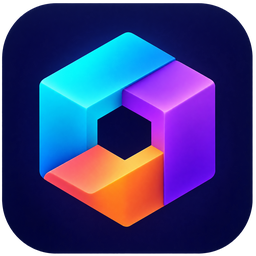

  

<h1 align="center">Studio3D</h1>

<strong>Создавайте 3D-модели и храните результаты в одной библиотеке.</strong>

  Плагин для <a href="https://grigdesk.com">GrigDesk</a>

  <a href="#установка">Установить</a> ·
  <a href="https://github.com/EvilDevRu/grigdesk-studio3d/releases/tag/v0.1.0">Версия 0.1.0</a> ·
  <a href="#использование">Использование</a> ·
  <a href="docs/README.md">Документация</a>

Studio3D объединяет генерацию, библиотеку, просмотр и обработку трёхмерных
моделей прямо в GrigDesk. Создавайте модели по описанию или изображениям,
импортируйте свои файлы и сохраняйте готовые результаты в проекты.

## Возможности

- **Создание моделей:** текст, изображение или несколько видов через Tripo;
  отдельные заказы и пачки с расчётом стоимости.
- **Библиотека:** поиск, фильтры, метки, проекты и дерево версий каждой модели.
- **Просмотр:** текстуры, сетка, кости, анимации, сравнение двух моделей и снимки.
- **Обработка:** локальные поворот и масштаб, доступные у поставщика операции
  с текстурами, скелетом, анимацией и числом полигонов.
- **Задачи и расходы:** ход выполнения, история заказов и учёт затрат.
- **Импорт и экспорт:** свои модели, готовые файлы и сохранение в проект.

## Установка

1. В GrigDesk откройте **Плагины** и нажмите **«Установить из Git…»**.
2. Укажите репозиторий `https://github.com/EvilDevRu/grigdesk-studio3d`
   и тег **`v0.1.0`**.
3. Проверьте подготовленный пакет, подтвердите установку и включите плагин
   во вкладке **«Установленные»**.
4. Для генерации настройте ключ Tripo в настройках GrigDesk. Ключ хранится
   в ядре приложения.

Для установки нужен выпуск с готовым пакетом. Рабочее дерево с `development/`
предназначено для разработки; порядок подготовки чистого выпуска описан
в [документации разработчика](docs/development.md).

Если переходите со встроенного раздела 3D, сначала выполните
[инструкцию перехода](docs/migration.md), сохранив библиотеку и профиль браузера.

## Использование

Нажмите **3D** в правой панели GrigDesk или **Ctrl+Shift+7**. Сочетание
можно изменить в настройках горячих клавиш. Панель разворачивается на весь экран;
на узком экране доступна страница `/ext/studio3d`.

- **«Создать»** — опишите модель, добавьте изображения или импортируйте свой файл.
  Перед платным запуском проверьте параметры и расчёт стоимости.
- **«Модели»** — откройте результат, выберите версию, сравните модели,
  выполните обработку или сохраните файл в проект.
- **«Задачи»** — следите за выполнением, историей заказов и расходами.

О завершении задания GrigDesk сообщает уведомлением с переходом к модели.
При неизвестном исходе запроса плагин не повторяет оплату автоматически.
Импорт своих файлов и локальные операции не создают платный заказ.

Подробнее: [создание и библиотека 3D](docs/guide/studio3d.md).

Лицензия: [MIT](LICENSE). Сведения о происхождении кода и сторонних
компонентах: [NOTICE](NOTICE.md).
